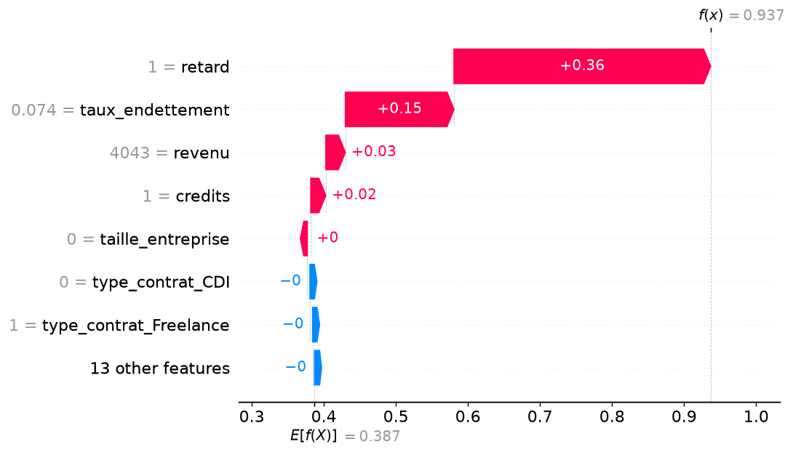

# CreditWise

Plateforme web d'aide à la décision d'octroi de crédit : un modèle de machine learning évalue chaque dossier client et SHAP explique les facteurs qui ont mené à l'accord ou au refus.

*Projet réalisé pendant mon stage d'été chez ITGust (juillet – août 2026).*

## Le problème

Un analyste crédit doit décider rapidement d'accorder ou non un crédit, à partir de nombreuses informations (revenu, ancienneté, crédits en cours, retards, taux d'endettement…). Une prédiction automatique seule ne suffit pas : l'analyste doit pouvoir **comprendre et justifier** chaque décision.

## La solution

- **Évaluation d'un dossier** : le modèle (Naive Bayes gaussien) calcule la probabilité d'accord à partir de 20 variables du client.
- **Explication de chaque décision avec SHAP** : graphique en cascade et « détail des facteurs principaux », c'est-à-dire les 6 variables les plus influentes, marquées *Favorable* ou *Défavorable* avec leur impact.
- **Explication globale** : importance de chaque variable sur l'ensemble des dossiers de référence.
- **Gestion des clients** : création, modification, suppression et fiche détaillée de chaque dossier.
- **Historique des demandes** : chaque évaluation est enregistrée avec son explication ; suivi du statut (en cours, soldé, en retard, refusé).
- **Statistiques** : nombre de demandes, taux d'acceptation.
- **Comptes et rôles** : connexion sécurisée, mot de passe oublié par e-mail, espace *analyste* et espace *administrateur* (supervision, gestion des comptes analystes).

## Démarche et architecture

**1. Préparation des données et choix du modèle** (notebooks `projet.ipynb`, `validation.ipynb`)

```
data.csv (2 970 dossiers) ─► nettoyage et création de variables (âge, ancienneté du dernier
mouvement, surendettement) ─► encodage (one-hot, ordinal) ─► 75 % entraînement / 25 % test
─► comparaison de 8 modèles ─► choix du Naive Bayes ─► model_naive_bayes.pkl
```

| Modèle | Accuracy (test) | F1-score (classe Accord) |
|---|---|---|
| Random Forest | 1,000 | 1,000 |
| Arbre de décision | 1,000 | 1,000 |
| SVM | 0,977 | 0,965 |
| Régression logistique | 0,974 | 0,960 |
| **Naive Bayes gaussien (retenu)** | **0,966** | **0,947** |
| Perceptron | 0,957 | 0,932 |
| SGD Classifier | 0,957 | 0,934 |
| KNN | 0,940 | 0,908 |

Le détail (données, préparation, matrices de confusion) est dans [`resultats_rapport/resume_resultats.md`](resultats_rapport/resume_resultats.md).

**2. Application web** (`app.py`)

```
Formulaire client ─► vecteur de 20 variables ─► Naive Bayes : probabilité d'accord
─► SHAP KernelExplainer : contribution de chaque variable ─► décision + graphique
─► enregistrement dans SQLite (historique)
```

| Fichier | Rôle |
|---|---|
| `app.py` | Application Flask : routes, évaluation, explications SHAP, espace administrateur |
| `models.py` | Modèles de données SQLAlchemy (analyste, client, crédit) |
| `password_utils.py` | Règles de robustesse des mots de passe |
| `seed_demo.py` | Données de démonstration fictives |
| `templates/`, `static/` | Pages HTML (Jinja2) et styles |
| `resultats_rapport/` | Scripts qui reproduisent les résultats et figures du rapport (évaluation, SHAP) |

## Technologies

- **Machine learning** : Python, Pandas, NumPy, Scikit-learn
- **IA explicable** : SHAP (KernelExplainer), Matplotlib
- **Application web** : Flask, Flask-Login, Flask-Mail, Jinja2
- **Base de données** : SQLite avec Flask-SQLAlchemy

## Aperçu



<!-- Capture de l'application à ajouter : enregistrez-la dans docs/capture.png puis remplacez cette ligne par :
 -->
*Capture d'écran de l'interface à venir.*

## Installation

Prérequis : Python 3.10 ou plus récent.

```bash
git clone https://github.com/Emnab2/CreditWise.git
cd CreditWise
python -m venv venv
venv\Scripts\activate              # Windows
# source venv/bin/activate         # macOS / Linux
pip install -r requirments.txt
```

Créez ensuite le fichier `.env` à partir du modèle fourni, puis remplacez `SECRET_KEY` par une valeur aléatoire :

```bash
copy .env.example .env             # Windows
# cp .env.example .env             # macOS / Linux
```

Les identifiants SMTP (`MAIL_USERNAME`, `MAIL_PASSWORD`) ne servent qu'à l'envoi de l'e-mail « mot de passe oublié » ; l'application fonctionne sans.

> **Données :** l'application a besoin du fichier `bd_validation.csv` (les 20 dossiers de référence utilisés par SHAP), à placer à la racine du projet. Les données clients du stage ne sont pas publiées dans ce dépôt.

## Utilisation

```bash
python app.py
```

L'application est disponible sur http://127.0.0.1:5000. Au premier lancement, la base `bank.db` est créée automatiquement.

Créer un compte administrateur :

```bash
flask --app app create-admin
```

Ajouter des données de démonstration fictives (3 analystes, des dossiers clients et leurs demandes) :

```bash
python seed_demo.py
```

**Exemple :** un analyste se connecte, ajoute un client (revenu, type de contrat, ancienneté, crédits en cours, retards…), puis lance l'évaluation. La page de décision affiche « Accepté » ou « Refusé », la probabilité d'accord et les 6 facteurs principaux : par exemple un taux d'endettement élevé apparaît comme *Défavorable*.

## Limites et pistes d'amélioration

**Limites actuelles**
- Random Forest et l'arbre de décision obtiennent un score parfait (100 %) : ce résultat est à analyser (fuite d'information possible ou décision très déterministe dans les données).
- Les classes sont déséquilibrées (environ 2 refus pour 1 accord) et aucun rééquilibrage n'a été fait.
- L'explication SHAP s'appuie sur seulement 20 dossiers de référence, et KernelExplainer est lent sur de gros volumes.
- L'application tourne en mode développement (`debug=True`) et n'est pas prévue pour la production en l'état.
- Les dépendances de `requirments.txt` ne sont pas figées à une version précise.

**Pistes d'amélioration**
- Validation croisée et analyse des variables pour vérifier l'absence de fuite d'information.
- Gestion du déséquilibre des classes (pondération, rééchantillonnage) et suivi du rappel sur les refus.
- Explications plus rapides (TreeExplainer avec un modèle à base d'arbres).
- Déploiement (serveur WSGI, configuration de production) et tests automatisés.

## Auteure

**Emna Brahmi** — élève ingénieure en Génie Informatique (ENICarthage)

- GitHub : [github.com/Emnab2](https://github.com/Emnab2)
- Portfolio : [emnab2.github.io/Portfolio](https://emnab2.github.io/Portfolio/)
